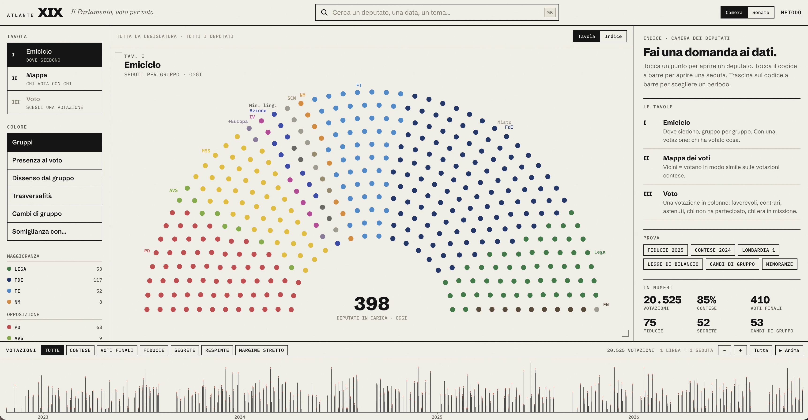

# Atlante XIX

**Il Parlamento, voto per voto.**



Un atlante interattivo di come hanno votato davvero deputati e senatori nella XIX legislatura: ogni parlamentare è un punto, ogni votazione una linea. Lo stesso punto resta sé stesso in tutto il sito; cambiano solo la sua posizione e il suo colore.

- **Tre tavole**: l'emiciclo (dove siedono, e chi ha votato cosa), la mappa dei voti (vicino = vota in modo simile), una votazione in colonne.
- **Sei lenti di colore**: gruppi, presenza al voto, dissenso dal gruppo, trasversalità, cambi di gruppo, somiglianza con un deputato.
- **Camera e Senato**: lo stesso esploratore per le due aule, con uno switch; i punti si dividono o si fondono passando da una all'altra.
- **Codice a barre** di tutte le votazioni (oltre 20.000 alla Camera): zoom fino alla singola seduta, filtri (voti finali, fiducie, segrete, contese…), selezione di un periodo, animazione mese per mese.
- **Schede** per deputato, votazione, seduta e gruppo; **confronto uno contro uno** tra due deputati.
- **Barra comandi** (⌘K): date, filtri, deputati, gruppi, circoscrizioni, leggi per tema, «Rossi vs Bianchi».
- **Link condivisibili**: tutto lo stato della vista è nell'indirizzo.
- **Metodologia pubblica**: ogni numero viene da una regola scritta, applicata a tutti nello stesso modo.

Fonti dei dati: [Camera dei Deputati — dati.camera.it](https://dati.camera.it) e [Senato della Repubblica — dati.senato.it](https://dati.senato.it) (CC BY).

---

## Avvio rapido

Serve Node.js 18 o più recente. I dati già calcolati sono nel repository.

```bash
cd site
npm install
npm run dev        # http://localhost:5173
```

`npm run dev` e `npm run build` copiano da soli i dati da `pipeline/data/final/{camera,senato}/` a `site/public/data/`. Lo switch del Senato si accende solo se ci sono i dati del Senato.

## Pubblicazione

```bash
cd site
npm run build      # → site/dist/
```

`site/dist/` è un sito statico: si carica così com'è su qualsiasi hosting (ad esempio via FTP su Apache), nella radice o in una sottocartella, perché tutti i percorsi sono relativi. Il file `.htaccess` incluso attiva la compressione gzip e la cache; controlla che venga caricato anche se il programma FTP nasconde i file che iniziano col punto.

Verifica della compressione:

```bash
curl -sI -H "Accept-Encoding: gzip" https://<dominio>/data/camera/votes_index.json | grep -i content-encoding
# atteso: content-encoding: gzip
```

---

## Come funziona

```
pipeline/fetch/scarica.py       →  pipeline/data/raw/camera/        votazioni e voti da dati.camera.it (SPARQL)
pipeline/fetch/missioni.py      →  pipeline/data/raw/camera/missioni/  missioni e presidenti di turno dalle schede ufficiali
pipeline/fetch/prepara.py       →  pipeline/data/clean/camera/      matrice dei voti (un carattere per deputato per votazione) e controlli
pipeline/analysis/analizza.py   →  pipeline/data/final/camera/      JSON del sito (~32 MB, ~6 MB compressi)

pipeline/fetch/scarica_senato.py   →  pipeline/data/raw/senato/     votazioni ed elenchi dei senatori da dati.senato.it
pipeline/fetch/prepara_senato.py   →  pipeline/data/clean/senato/   stessa matrice della Camera (con V: presente non votante)
pipeline/analysis/analizza.py senato  →  pipeline/data/final/senato/  stesse regole, stessi JSON
site/                           →  site/dist/                       sito statico
```

In breve (i dettagli sono nella metodologia, dentro il sito):

- **Maggioranza e opposizione** vengono dai voti di fiducia: chi sostiene il Governo nelle questioni di fiducia e respinge le mozioni di sfiducia è in maggioranza.
- Una votazione è **contesa** quando maggioranza e opposizione votano in modo diverso (contando i parlamentari, non i gruppi): sono l'85% delle votazioni valide alla Camera e l'89% al Senato.
- L'**accordo** tra due deputati è la quota di votazioni in cui hanno votato allo stesso modo, tra quelle in cui hanno votato entrambi (minimo 50 in comune).
- La **mappa** proietta in due dimensioni le distanze 1 − accordo sulle votazioni contese (MDS pesato, SMACOF), con mappe annuali e mensili allineate (Procrustes).
- La **posizione di un gruppo** è il voto più frequente dei suoi membri, calcolata senza il voto del deputato che si sta misurando.

### Aggiornare i dati

I comandi sono pensati per macOS (`caffeinate` tiene sveglio il Mac durante lo scarico); su Linux basta toglierlo.

```bash
caffeinate -i python3 pipeline/fetch/scarica.py      # 1. votazioni e voti (solo quelli nuovi)
caffeinate -i python3 pipeline/fetch/missioni.py     # 2. missioni e presidenti di turno
python3 pipeline/fetch/prepara.py                    # 3. matrice dei voti e controlli
python3 pipeline/analysis/analizza.py                # 4. JSON del sito
cd site && npm run build                             # 5. sito
```

Per il Senato:

```bash
caffeinate -i python3 pipeline/fetch/scarica_senato.py   # 1. circa un'ora: il Senato chiede pause tra le richieste
python3 pipeline/fetch/prepara_senato.py                 # 2. matrice dei voti e controlli
python3 pipeline/analysis/analizza.py senato             # 3. JSON del sito
```

Gli incarichi di Governo dei senatori vengono dai dati della Camera: lancia prima il passo 1 della Camera.

L'endpoint del Senato accetta solo richieste GET brevi e blocca chi ne fa troppe ravvicinate (403): lo script aspetta 5 secondi tra una richiesta e l'altra e, se viene bloccato, si ferma; rilanciato, riparte dalle sedute che mancano.

- Gli script di scarico e preparazione usano solo la libreria standard di Python (3.9+) e `curl`. `analizza.py` richiede `numpy` (`pip3 install numpy`).
- Gli scaricamenti riprendono da dove si erano interrotti: basta rilanciare lo stesso comando.
- Ogni passo scrive un `controllo.txt` (voti individuali contro totali ufficiali, verifica delle missioni, riepilogo della matrice).
- I dati grezzi (~1 GB) e la matrice non sono nel repository: si rigenerano con i passi 1–3.

---

## Struttura del sito

Vite + TypeScript, nessuna libreria a runtime. I punti e il codice a barre sono disegnati su canvas; le animazioni sono scritte a mano e rispettano `prefers-reduced-motion`.

| File | Cosa fa |
|---|---|
| `index.html` | Schermata di caricamento, introduzione, esploratore, metodologia |
| `src/main.ts` | Avvio: caricamento → introduzione o esploratore |
| `src/intro.ts` | Caricamento (emiciclo di 100 punti) e introduzione guidata dallo scroll |
| `src/app.ts` | Esploratore: stato, controlli, schede, barra comandi, versione per telefono |
| `src/engine.ts` | Motore dei punti: interpolazioni e disegno su canvas |
| `src/layouts.ts` | Emiciclo, mappa (con i punti scostati per non sovrapporsi), colonne di una votazione |
| `src/stage.ts` | Posizioni e colori della tavola per lo stato corrente |
| `src/lenses.ts` | Lenti di colore e legende |
| `src/barcode.ts` | Codice a barre: zoom, periodo, animazione nel tempo |
| `src/cards.ts` | Schede: deputato, votazione, seduta, confronto, gruppo, elenchi |
| `src/search.ts` | Barra comandi |
| `src/table.ts` | Indice dei deputati |
| `src/method.ts` | Pannello della metodologia |
| `src/data.ts` | Caricamento dei JSON e funzioni sui dati |
| `src/state.ts` | Stato dell'esploratore e indirizzo condivisibile |

### Link condivisibili

- `?vista=mappa&lente=presenza&da=2024-01-01&a=2024-12-31`
- `?vista=emiciclo&lente=somiglianza&d=<id deputato>`
- `?vista=voto&v=vs19_590_001`
- `?aula=senato&vista=emiciclo` — il Senato
- `?vista=mappa&confronto=<id1>,<id2>`
- `#metodologia`, `#m-accordo` — apre la metodologia (anche a una sezione)

Chi arriva da un link entra direttamente nell'esploratore.

---

## Prossimi passi

- **Due camere**: la stessa legge votata alla Camera e al Senato, a confronto.
- **Ricerca per comune**: richiede la tabella comune → collegio 2022; per ora si cerca per circoscrizione.

## Crediti

Progetto di [EDOEDOEDO](https://www.edoedoedo.it/) — [GitHub](https://github.com/EdoEdoEdo) · [LinkedIn](https://www.linkedin.com/in/edoardo-di-sabatino-1053b711b/).

Dati: Camera dei Deputati — dati.camera.it e Senato della Repubblica — dati.senato.it, licenza [CC BY](https://creativecommons.org/licenses/by/4.0/deed.it). Caratteri: Schibsted Grotesk, IBM Plex Mono e Newsreader (Google Fonts).
